FreeQuestSystem is a reusable Quest System for Unreal Engine 5, originally based on the Blueprint implementation created by [Ryan Laley](https://www.youtube.com/@RyanLaley) in his [Quest System Tutorial Series](https://www.youtube.com/watch?v=_SlvjzniqyU&list=PL4G2bSPE_8unYoX6G_UUE5QIzbySCUR_8&index=1).

I used Ryan's original Blueprint implementation as the foundation, extending its functionality, introducing additional features, and developing a C++ implementation to make the system more flexible and accessible to both Blueprint and C++ developers.

   
  

## About FreeQuestSystem

FreeQuestSystem is a ready-to-use, component-based Quest System for Unreal Engine 5, designed to help developers implement quest mechanics into their own projects.

The system provides the core functionality needed to manage the quest lifecycle, including quest acceptance, objective progression, quest completion, turn-in interactions, quest tracking, UI notifications, and save/load functionality.

Built with both Blueprint and C++, FreeQuestSystem offers a modular architecture that developers can integrate immediately and customize to fit their game's requirements.

## Feedback & Stay Connected

Your feedback helps improve FreeQuestSystem!

If you encounter bugs, have suggestions, or want to request new features, please share your thoughts through our [Feedback Form](https://docs.google.com/forms/d/e/1FAIpQLSe8jffAcZLxNQQ1qfADg_X02w1zZXBaPSkhfwXPeM9xOqUjvQ/viewform?usp=publish-editor).

You can also leave your email to receive updates about new FreeQuestSystem features, upcoming Black Sheep Studios products, games, books, and newsletters.

## Support the Project

If FreeQuestSystem helps you with your development, consider supporting its continued development by [buying me a coffee](https://buymeacoffee.com/alexandresb).

If you find this repository useful, please consider giving it a ⭐. It helps other developers discover the project and motivates further development!

Want to contribute? Fork the repository, make your improvements, and submit a Pull Request. I'll review contributions and work with the community to make FreeQuestSystem better for everyone.

## Architecture

FreeQuestSystem uses a component-based architecture that separates quest management, player interaction, quest-related actors, and user interface functionality.

Each component has a specific responsibility, allowing developers to integrate the system into their existing characters and actors without relying on project-specific gameplay classes.

### Core Components

#### Player Components

**Interaction Component (`UMR_InteractionComponent`)**

Handles player interactions with quest-related actors and components.

Its responsibilities include:
- Performing interaction traces.
- Detecting interactable quest components.
- Prioritizing available interactions.
- Executing the appropriate interaction.
- Handling Quest Log open/close requests.

The component exposes `DoInteract()` through `BlueprintCallable`, allowing developers to trigger interactions using either C++ or Blueprint input handling.

For example, developers can call `DoInteract()` from their character's C++ input function or connect an input event directly to the Interaction Component in Blueprint.

The component also exposes functionality for toggling the Quest Log, allowing developers to open and close the interface through C++ or Blueprint.

<table>
  <tr>
    <th>BP Components</th>
    <th>BP Interaction</th>
    <th>C++ Interaction</th>
  </tr>
  <tr>
    <td>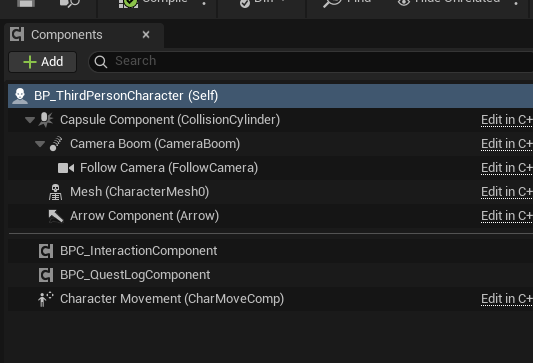</td>
    <td>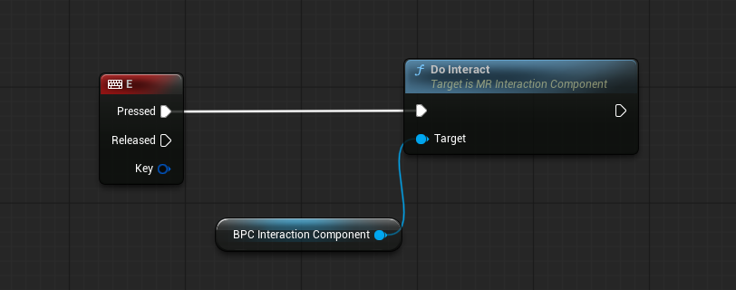</td>
    <td>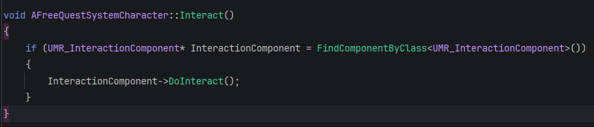</td>
  </tr>
</table>

 

**Quest Log Component (`UMR_QuestLogComponent`)**

Manages the player's quest log and all registered quests.

Its responsibilities include:
- Managing the player's quests.
- Handling quest acceptance and progression.
- Managing quest completion.
- Keeping track of the currently tracked quest.
- Managing the Quest Log widget and its contents.

The Quest Log interface can be opened and closed through the system's toggle functionality.

Ok Now quest log component its the easiest we already stablished the components so we need a quest log print talking about widgets we should setup QuesTracker and QuestLog

<table>
  <tr>
    <th>BP Components</th>
    <th>BP Interaction</th>
    <th>C++ Interaction</th>
    <th>QuestLog Details</th>
  </tr>
  <tr>
    <td></td>
    <td>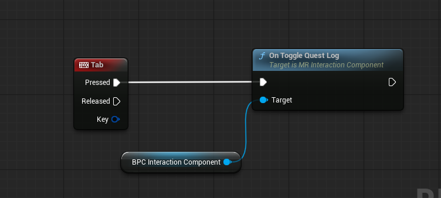</td>
    <td>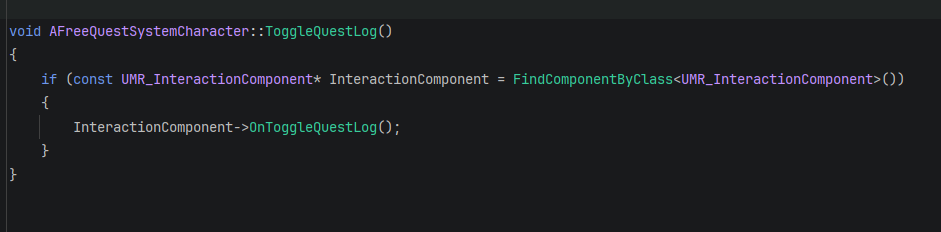</td>
    <td>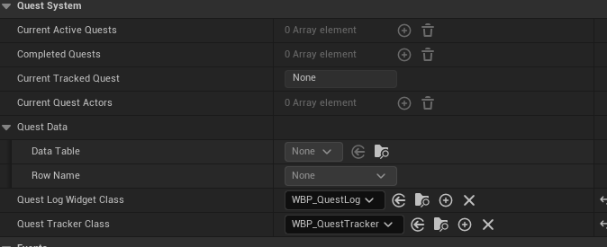</td>
  </tr>
</table>

### Quest Interaction Components

These components are attached to actors that participate in the quest system.

**Quest Giver Component** & **Quest Completer Component**

<table>
  <tr>
    <th>BPC QuestGiverComponent</th>
    <th>BPC QuestGiverComponent Details</th>
    <th>BPC QuestCompleterComponent Details</th>
  </tr>
  <tr>
    <td>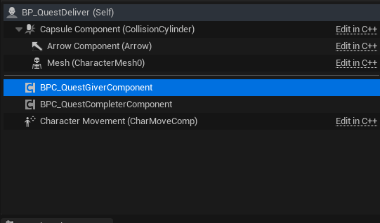</td>
    <td>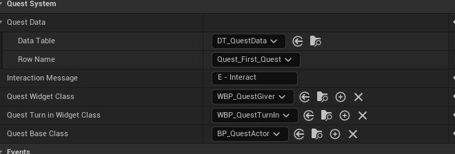</td>
    <td>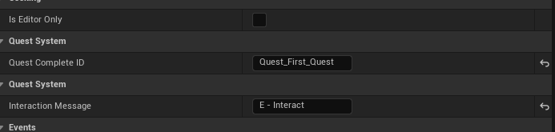</td>
  </tr>
</table>

**Quest Giver Component**

Allows an actor to offer quests to the player and handle quest acceptance.

The component uses `DT_QuestData` to configure which quest the NPC offers. Developers select the appropriate Data Table Row, which serves as the Quest ID.

The component also allows developers to configure:

- `QuestGiverWidget`: Widget displayed when offering a quest.
- `QuestTurninWidget`: Widget associated with quest turn-in.
- `BPQuestActor`: Blueprint actor associated with the accepted quest.

**Quest Completer Component**

Allows the player to turn in and complete quests when a separate completion interaction is required.

Each quest has a unique ID corresponding to its Data Table Row Name. To configure a Quest Completer, developers specify the Row Name of the quest they want that actor to complete.

**Quest Objective Component**

<table>
  <tr>
    <th>BPC QuestObjectiveComponent</th>
    <th>BPC QuestObjectiveComponent Details</th>
    <th>DT ObjectiveID</th>
  </tr>
  <tr>
    <td>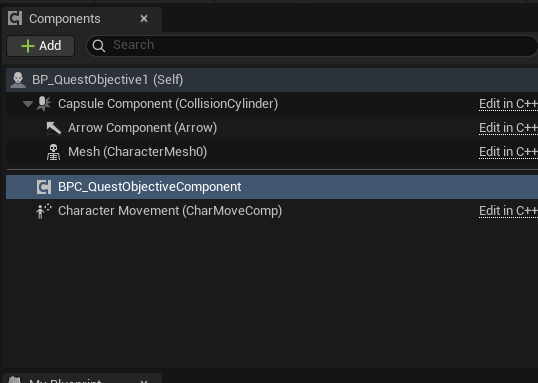</td>
    <td>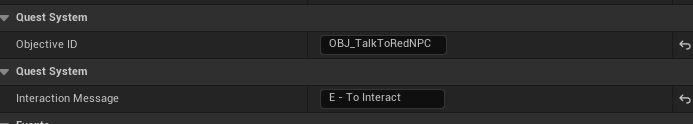</td>
    <td>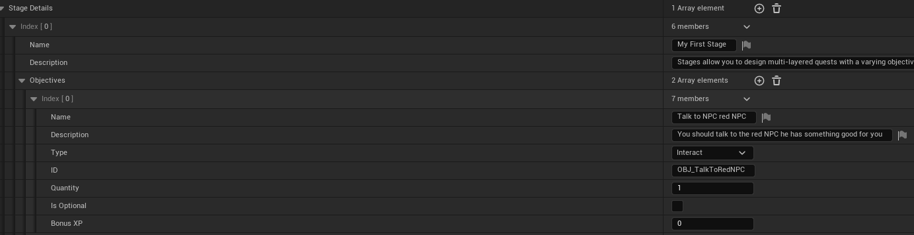</td>
  </tr>
</table>

Handles interactions associated with quest objectives and contributes to quest progression.

Each objective has its own unique ID, which developers can define in code. This ID is used to identify and complete the corresponding objective.

### Quest Identification

FreeQuestSystem uses two levels of identification:

- **Quest ID:** The Data Table Row Name identifying a quest.
- **Objective ID:** A unique ID assigned to each objective, used to identify and complete individual objectives.

This allows the system to identify both the quest being managed and the specific objective being progressed.

### Quest Data and Supporting Classes

**Quest Base (`AMR_QuestBase`)**

Represents an accepted quest instance and provides its runtime representation.

**Quest Data (`FQuestDetails`)**

Contains the quest information and objective data used by the system.

### Saving and Loading

Saving and loading are handled separately from the Quest Log Component.

FreeQuestSystem uses the GameMode, GameInstance, and SaveGame classes to manage persistence.

This separation keeps quest management independent from the game's save system.

### User Interface

FreeQuestSystem includes widgets for displaying quest information and communicating quest-related events to the player.

The Quest Log Component manages the Quest Log widget, while the Interaction Component provides the functionality to toggle its visibility.
